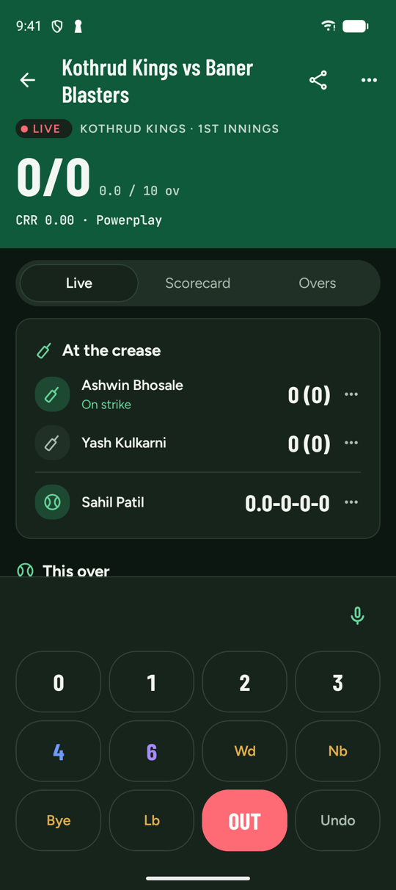
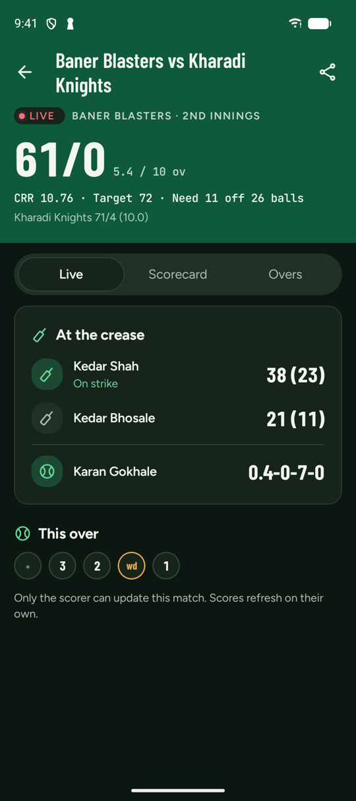
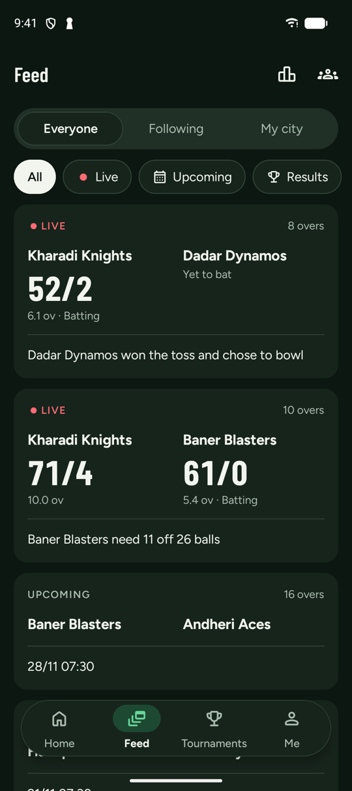
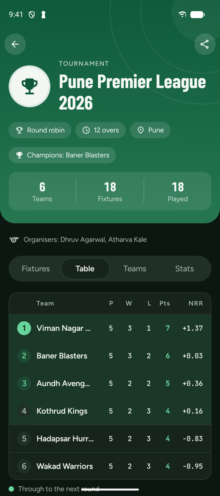
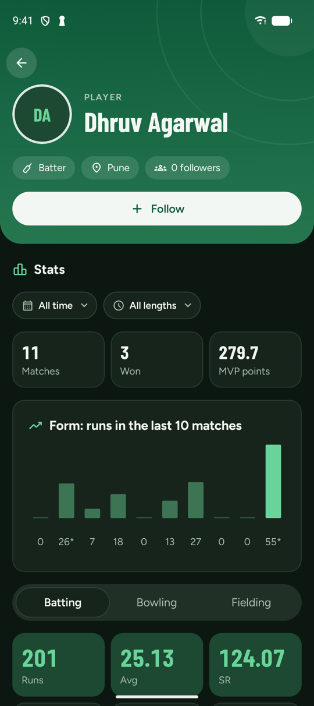
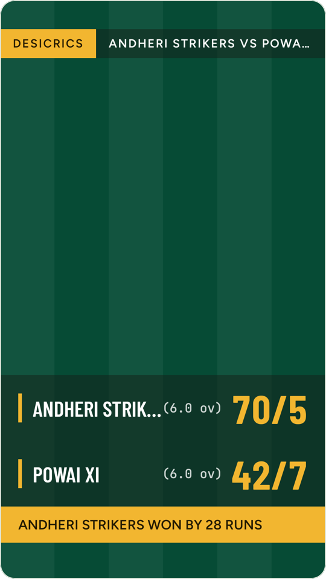
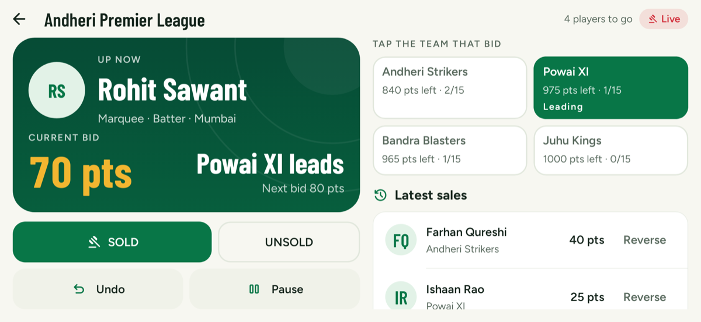

  

<h1 align="center">DesiCrics</h1>

<b>Score, follow and run amateur cricket, from gully games to weekend leagues.</b>

Local cricket in India runs on WhatsApp groups and paper scorebooks. Scores get lost, stats never add up
across seasons, and nobody outside the ground can follow the game. DesiCrics puts it all in one place:
score every ball with one thumb, let anyone follow live, and watch career stats build up on their own.

  
  
  

## Score a match

- **Set up in a minute.** Pick the teams and squads, choose the rules, do the toss. T20 with a tennis ball is
  the default; overs, ball and pitch type, power plays and venue are all yours to change.
- **Play by your rules.** Last man stands, retired batters coming back, back-to-back overs, free hits:
  start from a Gully, Club or Standard preset and switch each rule off, to a warning, or enforced.
- **One-thumb scoring.** A run pad within reach of your thumb, a wicket sheet that asks only what matters,
  undo, substitutes, revised targets and a wagon wheel. Made to read in bright sunlight.
- **Just want to score?** Simple mode hides everything else and leaves the scoring and your teams.

## Follow the game

- **Live for everyone.** Share a link and family, teammates or rivals watch the score move, ball by ball,
  with the full scorecard, overs and commentary. No app needed: it opens in any browser.
- **A feed of your cricket.** Your own match first, then the teams and players you follow, then what's on in
  your city.
- **Notifications** when a match starts, a followed player hits a milestone, or a result comes in.

## Run a tournament

  
  
  

- **Leagues and cups.** Knockouts, round robins, box leagues, groups and finals, with fixtures, a points table
  with net run rate, and top performers.
- **Entries and squads.** Teams register, players join the pool, and organisers approve squad changes.
- **Player auction.** Give each team a purse and sell players one at a time, in a hall on one big screen or
  online with every owner bidding from their own phone.

  

## Stats that build themselves

- **Career stats** from every ball scored: batting, bowling and fielding, by season and format, with a form
  chart and head-to-head player comparison.
- **MVP points** rank everyone in a match with [one published formula](docs/features.md#mvp-points), and
  pick the player of the match and of the tournament.
- **Leaderboards and rankings** for your city, your tournament and your friends, with team ratings weighted
  by the strength of the opposition.

## Share it

Scorecards, milestones, fixtures, brackets, points tables, squads and results become posters and
Instagram-style overlays, sized for WhatsApp status and stories. Pick a template, pick a theme, share.

## Find your people

Post what you're looking for (an opponent, a player, a ground, an umpire or a scorer) and let others reply.
Browse a directory of local grounds and officials, and join teams through an invite link or a QR code.

## Make it yours

Pick a cricket-inspired theme (Red Ball, Floodlights, Gully, Scoreboard or Classic) in light or dark.

## Where it runs

- **Android app** for scoring, organising and everything else.
- **Web app** for following matches, tournaments, teams and players from any browser, including iPhones.

---

Building DesiCrics or running it locally? See [docs/development.md](docs/development.md) for setup, and
[/docs](docs) for the product, design and architecture docs.
