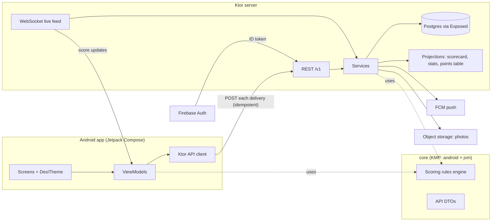

# Architecture

The repo stays a Kotlin Multiplatform build, but only to share code between the Android app and the JVM server. The iOS target gets switched off until it's needed.

Scoring is event-sourced: every delivery is an immutable event. Scorecards, stats, partnerships and points tables are projections the server builds from those events.



## Stack

| Layer | Choice | Notes |
|---|---|---|
| Android UI | Jetpack Compose, Material 3 + `DesiTheme`, Navigation Compose with type-safe routes | Single activity, edge-to-edge, min SDK 26 |
| Android data | Ktor client, DataStore, Koin, Coil 3 | No local database: scoring is online, and each ball is saved on the server before the next |
| Shared | `core`: `DeliveryRules`, DTOs, validation | The same code checks a ball on the device and on the server |
| Server | Ktor 3, Exposed, Postgres (H2 for tests), Flyway | All scoring rules and permission checks live here. Database chosen by `DATABASE_URL` |
| Auth | Firebase Auth on device, Firebase Admin SDK token check on the server | Phone OTP and Google sign-in |
| Realtime | Ktor WebSockets (SSE fallback), one channel per match | Followers subscribe; scorers write over REST |
| Push / crashes | FCM, Crashlytics | |
| Infra | Cloud Run + Cloud SQL, or Fly.io + Neon | Undecided; one container either way. GitHub Actions for CI |

See [ADR 0001](decisions/0001-backend-stack.md) for why there is no Supabase or Firestore.

## Modules

```
core/                 shared rules engine + DTOs (android + jvm targets)
server/               Ktor app: routes, auth, services, stores, migrations
app/shared/           Android app code (to be split into feature modules as it grows)
app/androidApp/       Android entry point
app/designsystem/     :app:designsystem: Crease tokens, fonts, components (see design-system.md)
```

## Core entities

- `User` (profile, role, batting style, bowling style)
- `Team`, `TeamMember` (role: admin / member)
- `Match` (type, overs, ball type, pitch type, venue, start time, status)
- `MatchSquad` (player, isCaptain, isKeeper, status)
- `Toss`
- `Innings`
- `Delivery` (innings, seq, over, ball, striker, non-striker, bowler, runs, extra type, extra runs, wicket type, dismissed player, fielder, fielding zone)
- `Tournament`, `TournamentTeam`, `Fixture` (group)
- `Follow`, `Notification`
- Projections (server-written only): `Scorecard`, `Partnership`, `PlayerStats`, `PointsTable`, `MvpPoints`

## Scoring contract

- The client sends a `Delivery` with a client-generated, per-innings `seq`. The server rejects gaps and duplicates, so retries are safe.
- Undo is a `VoidDelivery` event. Nothing is ever deleted.
- Only the match's scorers can write. There is one active scorer at a time, and the role can be handed over.
- Every write returns the new innings state, so the client never computes the score on its own.
- `DeliveryRules` in `core` validates a delivery before it leaves the device, and again on the server.
