# Phase 7 · Show it off

**Goal:** what happens in a match leaves the app looking good, and a league can be run from its auction to its final.

The four features are built one at a time, in this order. Each one ships on `main` before the next one starts.

| # | Feature | Why it goes here |
|---|---|---|
| 7.1 | [Wagon wheel first](#71-wagon-wheel-first) | It's the smallest change, it touches scoring, and the cards and posters after it need shot data for most matches, not just a few. |
| 7.2 | [Share studio and overlays](#72-share-studio-and-overlays) | Builds the template and rendering system that 7.3 reuses, starting with Strava-style transparent overlays. |
| 7.3 | [Posters](#73-posters) | Adds more content (fixtures, results, tables, squads) on top of the studio from 7.2. |
| 7.4 | [Player auction](#74-player-auction) | The largest piece: new server state, live rooms and a big-screen layout. It also gets a poster ("Sold!") from the studio. |

## Build plan: parallel worktrees

The order above is the order features ship in. The work itself runs in parallel: each track is built on its own branch in its own git worktree, and the branches are merged into `main` one at a time.

### What can run at the same time

| Track | Branch | Depends on | Touches |
|---|---|---|---|
| **A** Wagon wheel first (7.1) | `phase7/wagon-wheel` | nothing | `MatchScreen`, `ScoringSheets`, `MatchRules` default, rules sheet |
| **B** Share studio and overlays (7.2) | `phase7/share-studio` | nothing | new `ui/share/`, `ShareCard`, `system/Share`, share entry points |
| **C** Auction engine and server (7.4, part 1) | `phase7/auction-server` | nothing | new `AuctionEngine` in `core`, migration `V19`, auction routes, auction WebSocket |
| **D** Match posters (7.3, part 1) | `phase7/posters-match` | B merged | result, scorecard and player of the match content in `ui/share/` |
| **E** Tournament posters (7.3, part 2) | `phase7/posters-tournament` | B merged | fixtures, bracket, points table, squad and announcement content in `ui/share/` |
| **F** Auction app (7.4, part 2) | `phase7/auction-app` | C merged | new auction screens and routes, the tournament screen's entry point |
| **G** Sold! and Team after auction posters | `phase7/auction-posters` | D or E, and F merged | auction content in `ui/share/` |
| **T1** Theme explorations ([Phase 8](phase-8.md)) | none: pictures, not code | nothing | design artifacts only |
| **T2** Theme infrastructure (Phase 8) | `phase8/theme-infra` | B merged | `:app:designsystem` only; the public `DesiTheme` API stays the same |
| **T3** The picked themes (Phase 8) | `phase8/themes` | T2 and all of Phase 7 merged | theme specs, fonts, the settings picker |

A, B and C don't share files, so they start together, and the theme explorations (T1) are made alongside them. D and E start once B's studio is on `main`, and F starts once C's API is. T2 runs alongside wave 2, since it only touches the design system. G is small and comes after F. The themes themselves (T3) wait for the user to pick directions and for Phase 7 to be merged.

### Gantt chart

```mermaid
gantt
    title Phase 7 tracks
    dateFormat HH:mm
    axisFormat %H:%M
    section Wave 1
    A Wagon wheel first             :a, 00:00, 2h
    B Share studio and overlays     :b, 00:00, 4h
    C Auction engine and server     :c, 00:00, 4h
    section Wave 2
    D Match posters                 :d, after b, 3h
    E Tournament posters            :e, after b, 3h
    F Auction app (Hall and Online) :f, after c, 4h
    T2 Theme infrastructure         :t2, after b, 3h
    section Wave 3
    G Auction posters               :g, after f, 1h
    Docs, roadmap and final check   :h, after g, 1h
    section Phase 8
    T1 Theme explorations           :t1, 00:00, 2h
    User picks directions           :milestone, pick, after t1, 0h
    T3 Picked themes                :t3, after h, 5h
```

The hours are relative estimates, not commitments.

### Merge rules

- **One merge at a time.** Rebase the branch on `main`, run the build and tests (`./gradlew build`, server tests and screenshot tests), then fast-forward `main`. The next branch rebases onto the new `main`.
- **Merge order within a wave** goes from smallest to largest (A, then B, then C), so the big branches absorb the conflicts.
- **Known conflict points** are resolved when rebasing, not avoided:
  - `strings.xml`: each track adds its strings in its own block, under a `<!-- Phase 7 · track -->` comment.
  - `AppNavigation.kt`: only F adds routes.
  - Migrations: `V19` belongs to C (V18 is the Kotlin public-codes migration). Any other track that needs a migration takes the next free number after rebasing.
  - Screenshot test files: each track adds its own test functions and only regenerates its own images.
  - Colours, corner radii and art come from `DesiTheme` tokens and never as literals, so Phase 8 themes restyle Phase 7 screens without edits.
  - Docs: tracks don't edit `roadmap.md`. Its status ticks are updated on `main` after each merge.
- **Each merge gets a quick review** of the diff before it lands, and the user audits each feature on `main`.

Decisions marked **(default)** were made without asking. Each one is easy to change before or during its build.

---

## 7.1 Wagon wheel first

Today the wagon wheel is off unless a match turns it on. When it's on, the scorer taps the runs and then picks a zone from a sheet. Phase 7 makes it the first step of every scoring shot.

- **On by default** for new matches and tournament rules. A match can still turn it off in the rules sheet, and the presets keep it on.
- **The field comes first.** While the wagon wheel is on, the crease area shows the 8-zone field above the run pad. The scorer taps where the ball went, the zone lights up, and the next run key records the shot with that zone. One extra tap per shot, and no sheet.
- **Dot balls, extras and wickets need no zone.** If no zone is armed, those keys work exactly as they do now. **(default)**
- **Runs without a zone:** if the scorer taps 1–6 with no zone armed, the zone sheet opens as it does today, with a Skip button. The ball is never blocked for want of a zone.
- **An armed zone clears** after the ball is recorded, after undo, and when the scorer taps the same zone again.
- **Budget phones:** the field gets a fixed, small height and the crease card gives way first, as it already does for the compact layout. The run pad keeps its full size.
- **Voice scoring** keeps working. A spoken "four" uses the armed zone if there is one, and otherwise opens the sheet.

No new data: `Delivery.zone` and `FieldZone` already exist. The rules engine still only accepts a zone on runs off the bat.

**Later (not in 7.1):** where a catch was taken, and a finer field (16 zones or tap anywhere for distance).

---

## 7.2 Share studio and overlays

One sheet, the **share studio**, for every picture DesiCrics makes. It replaces the single-card `ShareImageSheet`.

- **Content** says what's being shared: a batting innings, a bowling spell, a match result, a scorecard, a player's season, and later fixtures, tables and auctions (7.3, 7.4).
- **Templates** say how it looks. Each type of content offers the templates that suit it, and the studio shows them as a swipeable row of live previews.
- **Formats:** 9:16 story (default) and 1:1 post. **(default)**
- **Sharing:** the system share sheet, plus Save to gallery.

### Overlays (Strava-style)

An overlay is a **transparent PNG**: white text and line art with no background, meant to sit on top of the user's own photo in an Instagram or WhatsApp story, the same way Strava's activity stats do.

- **Batting:** runs (balls) large, then SR and 4s / 6s, with the mini wagon wheel drawn as outline sectors when the innings has zone data.
- **Bowling:** figures large (3/18), then overs and economy, plus the wickets taken with how each fell.
- **Result:** both totals and the result line, with the player of the match.
- **Season:** runs or wickets for the season, matches, best score, and a form sparkline.

Each overlay ends with the DesiCrics mark and the match or season name in small type.

- The preview sits on a checkerboard so the transparency is visible, with a toggle to preview it over a sample dark photo.
- PNG keeps the alpha channel. WhatsApp flattens transparency to black, so the studio says "Best on Instagram stories" next to overlay templates. **(default)**
- Text gets a soft shadow so it still reads on bright photos.

### Opaque templates

The current 9:16 card becomes the **Classic** template. Two more come with 7.2:

- **Broadcast:** a TV lower-third and scorebug look in brand green and gold.
- **Minimal:** an off-white paper card with large numerals.

### Build notes

- Templates are composables in `:app:shared` under `ui/share/`, drawn at a fixed design size (1080 × 1920) and scaled for the preview. The picture comes from the composable itself, so it's exactly what's previewed.
- `rememberShareImage` gains a format option (PNG with alpha for overlays, JPEG for opaque templates).
- The studio opens from the match screen (scorecard, result, innings), the profile stats tab (season) and the batter and bowler rows on the scorecard (that player's innings).

---

## 7.3 Posters

Posters are studio content for organisers and teams. Each kind gets 3–4 templates so a league doesn't look the same every week.

| Content | Templates |
|---|---|
| **Fixtures:** a day's matches, or a round | Matchday card, Broadcast list, Minimal list, Versus tiles |
| **Draw / bracket:** knockout stages | Bracket, Road to the final |
| **Result:** one match | Big score, Broadcast, Minimal, Overlay |
| **Scorecard:** both innings | Full card, Top performers |
| **Points table** | Table, Minimal table |
| **Squad:** team announcement for a match or tournament | Team sheet, Player grid |
| **Player of the match / tournament** | Spotlight, Overlay |
| **Tournament announcement:** dates, venue, format, entries open | Hero, Minimal |

- Posters use the tournament's name, team logos and player photos where they exist, and initials where they don't.
- Long fixture lists split into numbered pages (1/3, 2/3…), and the studio shares them together.
- Entry points: the tournament screen (fixtures, bracket, table, announcement), a finished match (result, scorecard, player of the match) and the team screen (squad).

---

## 7.4 Player auction

An auction fills tournament squads the way local IPL-style leagues do. Each team has a purse, and players come up one at a time and are sold to the highest bidder.

### Setup (both modes)

- An organiser **creates an auction for a tournament** before it starts. The auction's teams are the tournament's confirmed teams.
- **Purse:** the same budget for every team, in **points** with a label the organiser picks ("₹ lakh", "pts", "coins"). No real money moves through the app. **(default)**
- **Squad limits:** the most players a team can buy, and the fewest it must end with.
- **Player pool:** the organiser adds players from search, by code, or as new placeholders. Each one gets a **base price** and an optional **category** (for example Marquee, Batter, Bowler, All-rounder, Wicketkeeper). Players can also ask to be added from the tournament's public page. **(default)**
- **Retained players:** before the auction a team can keep players at a set price, which comes off its purse.
- **Bid steps:** the organiser sets increments, for example +5 up to 50 and +10 after that.
- **Order:** by category, then randomly within it, or entirely random. Unsold players can come back in a final round.

### Mode 1 · Hall (everyone in one room)

- One device runs it, usually the organiser's phone or tablet on a TV or projector, in a **landscape big-screen layout**: the player card (photo, role, styles, career stats), the current bid and the team leading, a purse strip for every team, and the last few sales.
- Team owners bid out loud or with paddles. The **auctioneer taps the bidding team**, and the bid goes up one step. Undo takes back the last bid or the last sale.
- **SOLD** and **UNSOLD** buttons end the lot, with a full-screen sold moment.
- Everyone else can watch live from their own phone, read-only.

### Mode 2 · Online (live bidding room)

- **Team owners bid from their own phones.** A team's admins are its owners by default.
- A **countdown** (default 15 s, reset to 10 s on each bid) ends each lot. The highest bid when it runs out wins, and with no bids the player goes unsold.
- The organiser runs the room: start, next player, pause and resume, and end a lot early or reverse a sale.
- Owners see their purse, their squad, and how much they can bid at most right now.

### Rules the server enforces

- A bid has to be higher than the current one by at least the step, and no more than a team can afford: **purse − (minimum squad still to fill × base price)**, so a team can always complete its squad.
- A team that's full can't bid.
- Only the organiser (Hall) or a team's owner (Online) can bid for that team.
- Every bid and sale is an event in an append-only auction log, like match events, so undo and replays come straight from it.

### When it ends

- Each sold player becomes a **member of the team they were sold to**, so they're offered when that team picks a squad for a fixture. Placeholders stay claimable as usual. **(default)**
- There's a summary for each team (players bought, money spent, money left), and the studio offers **Sold!** and **Team after auction** posters.

### Build notes

- `AuctionEngine` in `core` is pure: auction state is a fold over the event list, just like `MatchState` over deliveries. The server checks every action against it.
- Live updates use the existing WebSocket setup with an auction channel. The countdown runs on the server, and clients only show it.
- A new migration adds `auctions`, `auction_players` and `auction_events`.

**Out of scope for 7.4:** right to match, trades after the auction, and anything to do with real payments.
